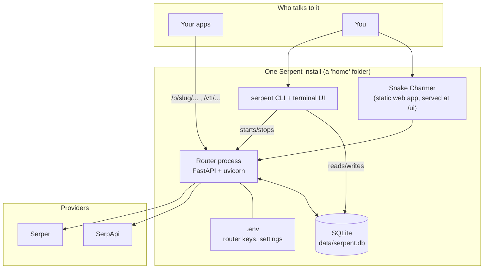
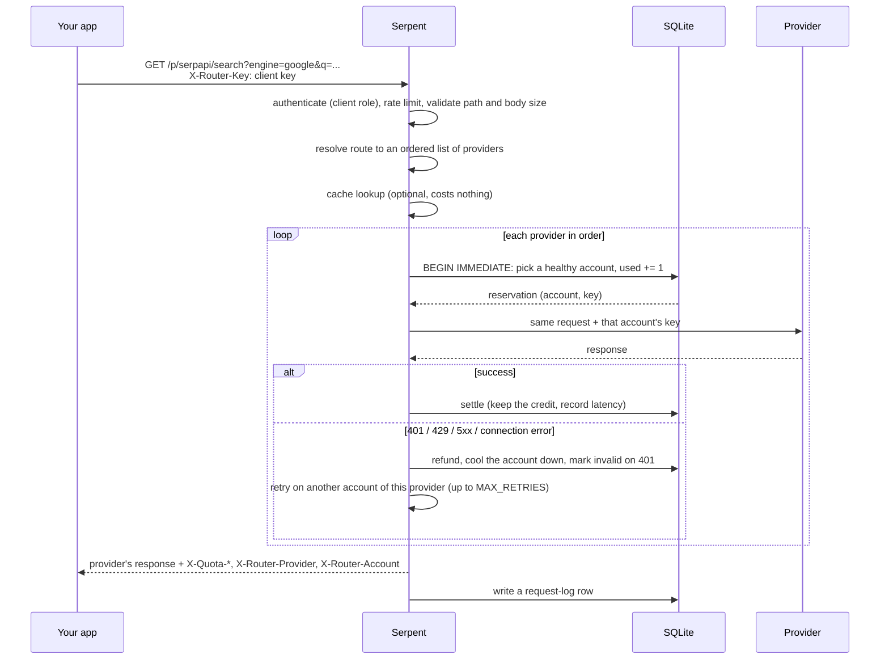
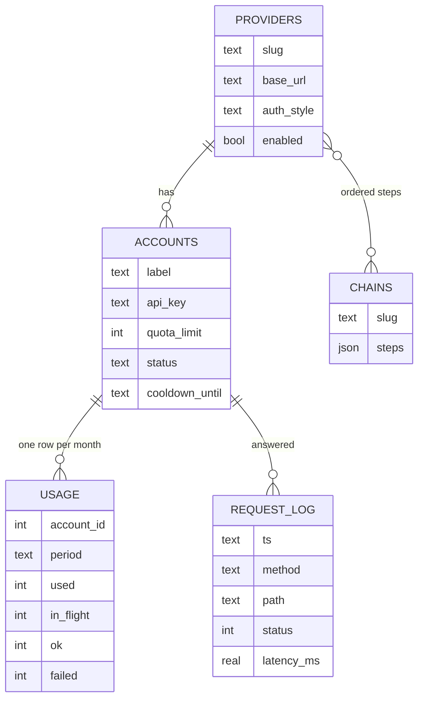

# Architecture

Serpent is deliberately small: one Python process, one SQLite file, three runtime
dependencies (FastAPI, uvicorn, httpx). This page explains the parts, what happens to a
request, where data lives and why it is built this way.

## The pieces



| Piece | What it is | Where |
| --- | --- | --- |
| Router | The HTTP service: authenticates callers, picks an account, forwards, counts. | `src/serpent/main.py` |
| Providers and chains | Data describing upstream APIs and ordered fallbacks. | `providers.py` |
| Quota ledger | Per-account, per-month usage with atomic reserve/settle. | `quota.py`, `db.py` |
| Accounts | Provider keys with a limit, a status and a cooldown. | `accounts.py` |
| Upstream | Builds the outgoing request (URL, key placement, header hygiene). | `upstream.py` |
| Security | Router keys, roles, constant-time comparison. | `security.py` |
| Contract | Generates the live "how to call this" page. | `contract.py` |
| Provider usage | Asks a provider what the plan allows (SerpApi). | `provider_usage.py` |
| Request log | Ring buffer of recent calls for the UI. | `requestlog.py` |
| Snake Charmer | Svelte web app, built into `src/serpent/ui_dist`, no CDN. | `ui/` |
| CLI and TUI | One command, `serpent`; stdlib `curses` terminal UI. | `cli.py`, `tui.py` |
| Install manager | Records what the installer made; uninstalls and verifies. | `uninstall.py` |

## Routes

| Address | Goes to |
| --- | --- |
| `/p/<slug>/<path>` | the provider or chain called `slug`; `<path>` is appended to the provider's base URL |
| `/v1/<path>` | the **default route** (a provider or chain you choose); `/v1/` is a convenience alias |
| `/v1/quota`, `/v1/quota/check` | credits left, capacity check (read key or higher) |
| `/v1/contract`, `/llms.txt` | the live API contract for apps and AI assistants |
| `/admin/*` | management API used by Snake Charmer and the CLI (admin key) |
| `/ui/` | Snake Charmer |
| `/healthz`, `/readyz`, `/metrics` | liveness, readiness, Prometheus |

> **Serpent does not translate between providers.** Whatever you send to `/p/serpapi/…`
> is what SerpApi receives (plus its key), and its answer comes back unchanged. A route is a
> door to one provider's API, so the caller must speak that provider's format. This is why
> chains work best between providers of the same type; the contract page warns when a chain
> mixes types.

## What happens to a request



Step by step:

1. **Authenticate and guard.** The caller needs at least the `client` role. The router rate
   limit (off by default), the body size cap and path checks (no traversal, no host
   override) run before anything is spent.
2. **Resolve the route** to an ordered list of enabled providers. A provider is a list of
   one; a chain is several.
3. **Cache** (optional, off by default). An identical request returns the stored answer and
   costs no credit.
4. **Reserve → forward → settle**, per provider. Reserving is one `BEGIN IMMEDIATE`
   transaction that picks an account and increments its counter, so concurrent callers can
   never overshoot a limit. Failures refund according to `REFUND_ON`, put the account on an
   exponential cooldown and retry on another account of the same provider. When a provider
   has nothing left, the next one in the chain is tried.
5. **Respond** with the provider's answer, unchanged, plus headers saying who answered and
   how many credits remain. If everything fails the last upstream response is returned with
   `X-Router-Error: all_accounts_failed`, a `502` if nothing could be reached, or a `429`
   with `Retry-After` when no credits are left.

Failure rules, rotation strategies and the quota model are in the
[Reference](reference.md#how-it-works).

## Data model (SQLite, WAL mode)



Plus a small `state` table (default route, round-robin cursor, runtime tunables). Migrations
are additive and run at startup. Months are keyed rows (`account_id`, `YYYY-MM`), so rollover
needs no scheduler: the first request of a new month simply creates a fresh row.

## Where things live

An install is one folder, its **home**. Everything Serpent creates is inside it:

```
<home>/
  .env                      settings and router keys (mode 0600)
  data/serpent.db           the database: accounts, provider keys, usage, history (0600, dir 0700)
  logs/                     server log
  run/                      pid and port of the running server
  .venv/                    private Python environment, if ./serpent created it
  .serpent-install.json     what the installer made, and this install's port
  deploy/serpent.local.service   generated systemd unit, if you asked for one
```

This is what makes `serpent uninstall` precise (it removes only what is listed, then
re-checks) and what lets you move or redeploy an install by copying `data/` and `.env`.

**One install, one port.** A home remembers its port. Starting it again reports that it is
already running instead of launching a second copy. A different folder gets the next free
port.

## Security model

- **Two kinds of keys.** Router keys (yours, in `.env`) let callers use Serpent. Provider
  keys (in the database) are used only by the server and are never sent to callers or shown
  in full again by the UI or API. The caller's router key is never forwarded upstream.
- **Roles.** `read` can look; `client` can also send requests; `admin` can change things.
  Compared in constant time.
- **At rest.** `.env`, the database and its WAL files are readable by your user only.
  Provider keys are stored as plain text in the database (see
  [Things to know](important-things.md#where-your-provider-keys-are-stored)).
- **Logs.** The request log records method, path, query string (with anything that looks
  like a credential removed), provider, account label, status and timing; never bodies,
  responses or keys.
- **Network.** A fresh install binds to `127.0.0.1`. Change `BIND_HOST` deliberately, and put
  TLS in front if you expose it ([Deploying](deploying.md#security-notes)).

## The interfaces on top

- **Snake Charmer** is a static Svelte app served by the router at `/ui/`. It talks to the
  same admin API as everything else, so anything it does you can script. The sign-in link
  `serpent up` prints carries the admin key in the URL *fragment*, which browsers never send
  to a server and the app removes from the address bar immediately.
- **The CLI** (`serpent`) is plain standard-library Python. Most commands read the database
  directly, so management works even when the server is stopped.
- **The terminal UI** (`serpent`, no arguments, in a terminal) is a tabbed, keyboard- and
  mouse-driven dashboard over the same operations, including diagnostics, backups and
  uninstall (see [Terminal UI](tui.md)).
- **The contract** (`/v1/contract`) is generated from the current providers and chains, so an
  application or AI assistant can learn exactly how to call this router.

## Design decisions

- **SQLite is the lock.** Quota atomicity lives in the database, not process memory, so
  several workers or processes can share one file and never overspend.
- **Providers are data, not code.** Anything that authenticates with a header, a query
  parameter or a bearer token works without writing a plugin.
- **Pass-through, not translation.** Translating between providers would hide their
  differences and lose fields. The router stays predictable; the contract and the Search
  tab help clients use each provider's own format.
- **Runtime versus environment settings.** Operational knobs (strategy, retries, reserve)
  change live from the UI; deployment facts (bind address, database path, router keys) stay
  in the environment so an install is reproducible.
- **Nothing is preconfigured.** A fresh install has no provider; you choose one.
- **No external assets.** Snake Charmer works on an offline network.
