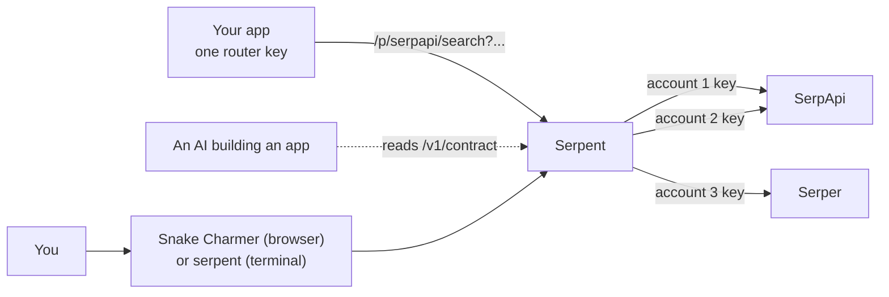

# Serpent documentation

Serpent is a small router that sits in front of search APIs. Your apps hold **one key**
and call **one address**; Serpent picks one of your provider accounts, adds that account's
key, retries somewhere else when something fails, and keeps an exact count of every credit
spent. **Snake Charmer** is its web interface; `serpent` is its command line and terminal UI.

## Where to start

| If you want to… | Read |
| --- | --- |
| get it running and make your first search | [Getting started](getting-started.md) |
| understand how the pieces fit and what happens to a request | [Architecture](architecture.md) |
| do a specific job (add an account, survive a reboot, move servers, build an app on it) | [Workflows](workflows.md) |
| avoid surprises | [Things to know](important-things.md) |
| look up an endpoint, setting or exact behaviour | [Reference](reference.md) |
| run it on a Raspberry Pi, under systemd or in Docker | [Deploying](deploying.md) |
| pool several accounts with one provider | [Responsible use](responsible-use.md) first |

## The idea in one picture

## Words used in these docs

| Word | Meaning |
| --- | --- |
| **Provider** | One upstream search API: its address and how its key is attached (header, query parameter or bearer token). |
| **Account** | One API key at one provider, with a credit limit you choose. A provider can have several accounts. |
| **Route** | An address on Serpent: `/p/<slug>/…` goes to a provider or chain; `/v1/…` goes to the default route. |
| **Chain** | An ordered list of providers. If the first is out of credits or failing, the next is tried. |
| **Credit** | One call to a provider. Serpent counts them per account per month. |
| **Router key** | What your apps (and you) use to talk to Serpent. Roles: `read`, `client`, `admin`. Not the same as a provider key. |
| **Home** | The folder holding one install's settings and data. Each home has its own port. |
